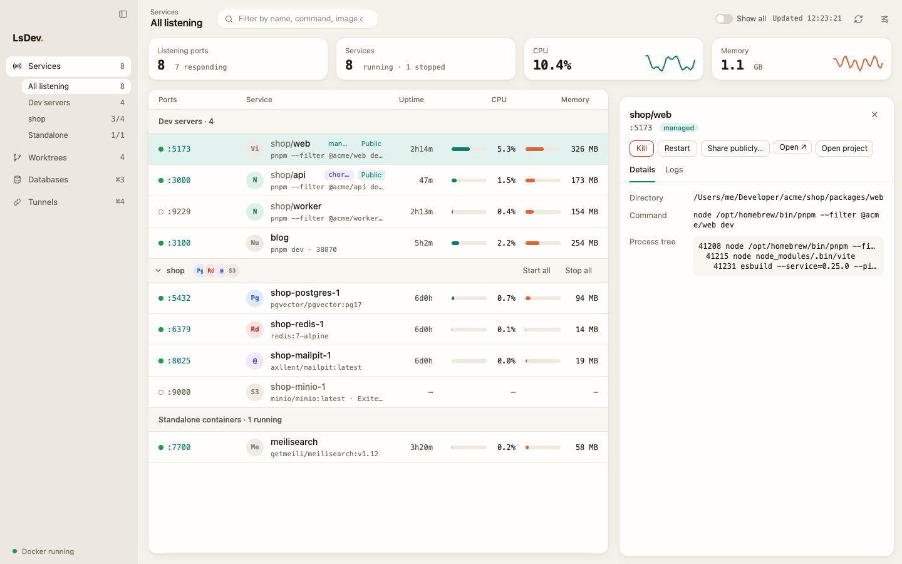
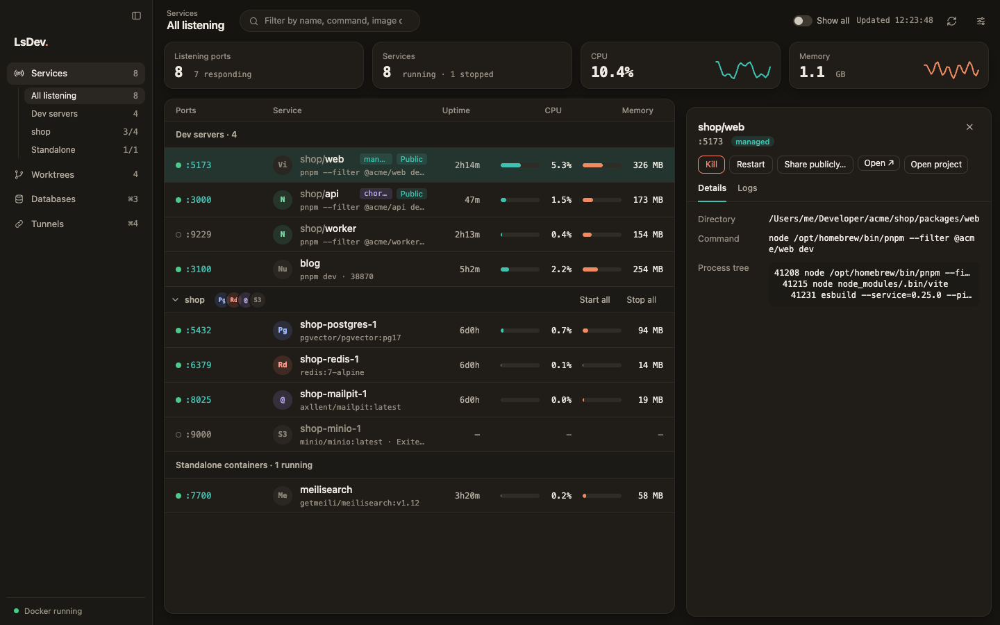
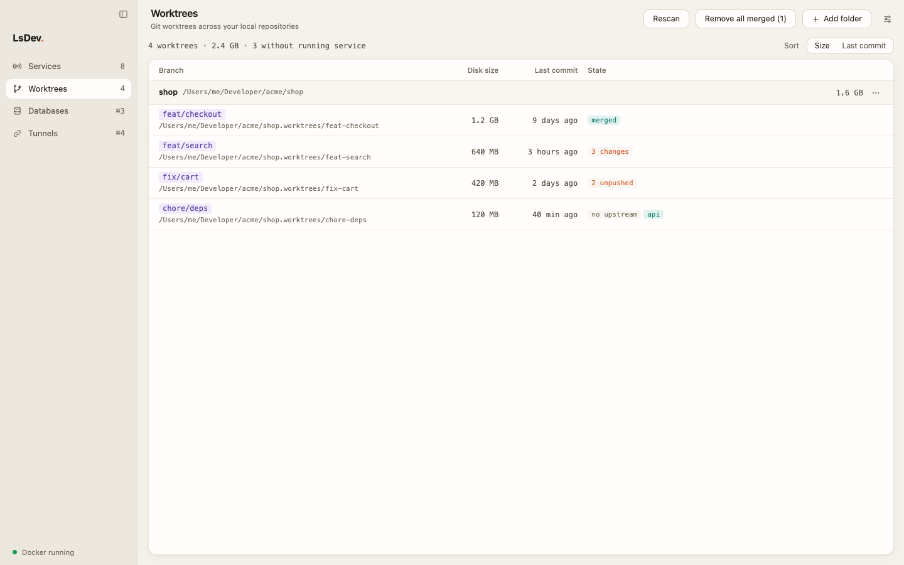
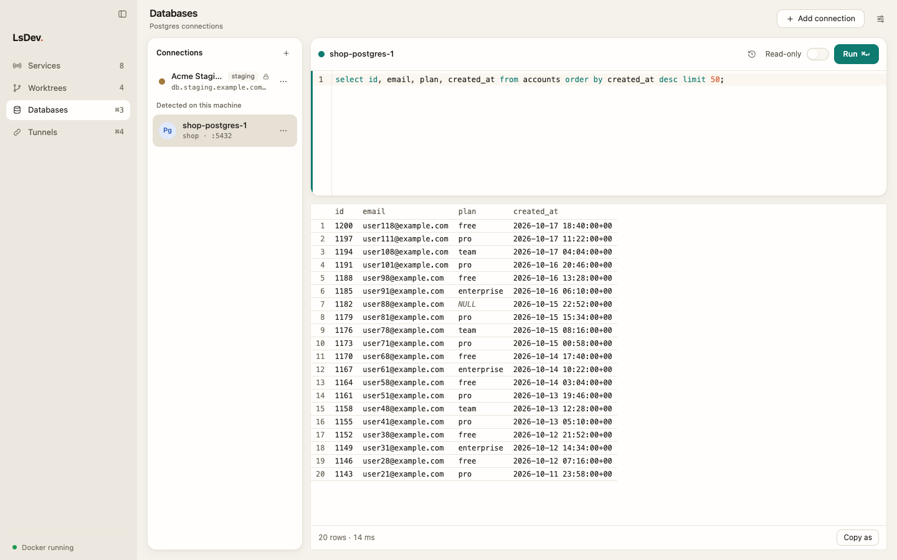
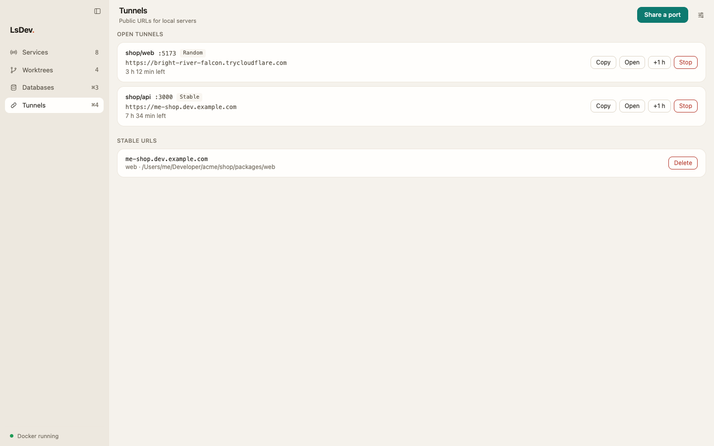

# LsDev

Application macOS qui liste les serveurs de dev (node, bun, deno) et les
conteneurs Docker de la machine, avec leurs ports. Elle permet de les arrêter,
de les redémarrer, de lire leurs logs, d'ouvrir le navigateur, l'éditeur ou un
shell dans un conteneur, et de retirer le worktree Git d'un service.

Elle remplace la CLI `ls-dev`.



## Aperçu

Services en thème sombre, avec le panneau de détail d'un process :



Worktrees : taille, dernier commit et état Git de chaque worktree :



Databases : connexions Postgres enregistrées ou détectées, éditeur SQL et résultats :



Tunnels : URL publiques Cloudflare ouvertes sur des ports locaux :



Les captures sont faites avec des données fictives : le frontend tourne dans un
navigateur avec un backend simulé (`scripts/screenshots/`). Avec `pnpm dev`
lancé, ouvrir
`http://localhost:1420/scripts/screenshots/index.html?tool=services&theme=light&detail=1`
(`tool` : `services`, `worktrees`, `databases` ou `tunnels` ; `theme` :
`light` ou `dark`).

## Construire en local

Prérequis :

- macOS 12 ou plus récent ;
- Rust stable, installé avec rustup (`rustup default stable`) ;
- Node 20.19+ ou 22.12+ (exigence de Vite) ;
- pnpm.

```bash
pnpm install
pnpm tauri build
```

L'app et le `.dmg` sont produits dans `src-tauri/target/release/bundle/`
(`macos/LsDev.app` et `dmg/`). Copier `LsDev.app` dans `/Applications`.

Le build n'est pas signé : au premier lancement, macOS refuse de l'ouvrir.
Faire un clic droit sur l'app puis « Ouvrir », ou retirer l'attribut de
quarantaine :

```bash
xattr -dr com.apple.quarantine /Applications/LsDev.app
```

### Build signé (optionnel)

Pour qui possède un certificat « Developer ID Application » : le script
`scripts/release-macos.sh` signe une app universelle (Apple Silicon et Intel),
la fait notariser par Apple et affiche le chemin du `.dmg`
(`src-tauri/target/universal-apple-darwin/release/bundle/dmg/`). Il lit les
identifiants de notarisation dans l'environnement : `APPLE_API_ISSUER`,
`APPLE_API_KEY` et `APPLE_API_KEY_PATH` (clé d'API App Store Connect), ou
`APPLE_ID`, `APPLE_PASSWORD` et `APPLE_TEAM_ID`.

```bash
./scripts/release-macos.sh
```

## Raccourcis

| Raccourci | Action |
| --- | --- |
| ⌘R | Rafraîchir la liste |
| ⌘F | Placer le curseur dans le filtre |
| ⌘, | Ouvrir les réglages |
| Esc | Annuler la confirmation ouverte, sinon fermer les réglages, sinon fermer le panneau de détail |

## Développement

Prérequis : Rust stable (`rustup default stable`), Node 22+, pnpm.

```bash
pnpm install
```

```bash
pnpm tauri dev
```

```bash
pnpm test && pnpm test:rust
```

Publier : pousser un tag `vX.Y.Z` ; la GitHub Action crée une release en
brouillon avec le `.dmg` universel.

## Comportements à connaître

- **Uptime du lanceur.** L'uptime, le pid et la commande affichés sont ceux du
  `pnpm dev` racine. Les watchers relancent le process feuille à chaque
  modification ; le lanceur dit depuis quand le serveur tourne.
- **Logs.** Disponibles pour les conteneurs, et pour les process relancés
  depuis LsDev (badge « managed »). Un process lancé dans un terminal n'a pas de
  sortie récupérable. Les logs des process relancés sont dans
  `~/Library/Logs/app.lsdev/`.
- **Restart.** LsDev relance la commande lisible (`pnpm --filter x dev`) dans le
  dossier du lanceur, via `$SHELL -lic`. Les variables exportées dans le
  terminal d'origine ne sont pas reproduites. Le process relancé survit à la
  fermeture de LsDev.
- **Sockets.** Résultat du spike netstat2 : PASS — netstat2 et lsof ont renvoyé
  les mêmes 34 couples (pid, port) ; lsof reste le repli.
- **Shell dans un conteneur.** « Open terminal » pilote Terminal ou iTerm par
  AppleScript ; macOS demande une autorisation d'automatisation au premier
  usage.

## Architecture

| Dossier | Rôle |
| --- | --- |
| `src-tauri/src/collect/` | collecte : process, sockets, Docker, worktrees ; boucle de fond |
| `src-tauri/src/actions/` | kill, restart, actions Docker, ouverture, retrait de worktree |
| `src-tauri/src/logs.rs` | flux de logs |
| `src-tauri/src/notify.rs` | notifications d'arrêt |
| `src/` | interface Vue |

## Licence

MIT. Voir [LICENSE](LICENSE).
